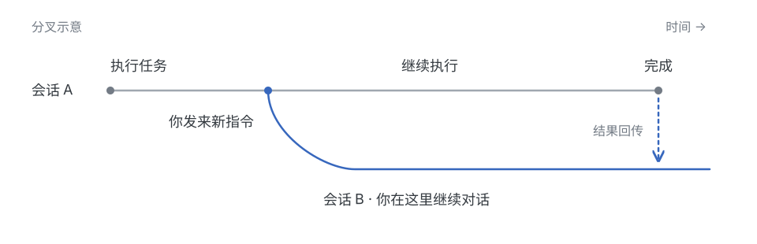
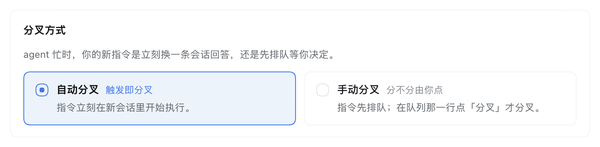
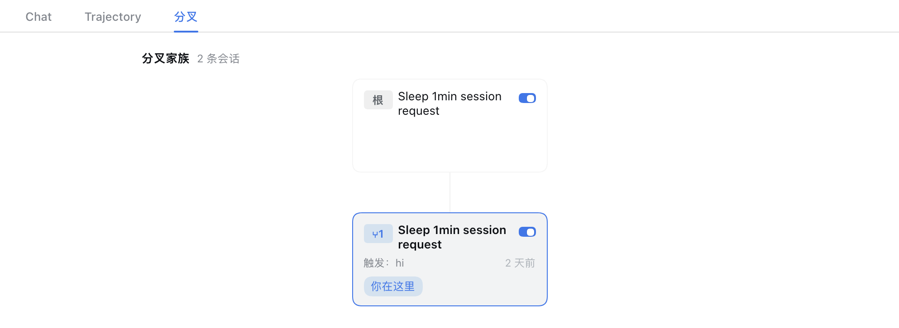

<h1 align="center">dsh-autofork</h1>

<p align="center">Agent 忙的时候，也能继续对话。</p>

你让 agent 跑一轮测试，中途又想讨论另一种实现。你不想停掉测试，也不想等它结束后才能说话。

**dsh-autofork** 是 DeepSeek Harness 的会话分叉插件：新指令交给新会话，旧会话继续工作，完成后把结果发回来。新会话带着已完成的上下文和当前进度摘要，不必重新交代背景。



## 安装

在已有的 DSH Web 环境中运行：

```sh
dsh plugin --profile web add github:vlln/dsh-autofork
```

## 兼容性

| dsh 版本 | 状态 |
|---|---|
| `0.2.0-rc.2` | ✅ 已验证：手动分叉排队与设置面（2026-10 实测） |
| `0.1.2-rc.1` | 早期行为层证据的基线；未在 0.2.0 线复验 |

换 dsh 版本后若某个能力失灵，先查 [开发说明](docs/engineering-notes.md) 的验证章节；跨基线复核前不要把旧结论当事实用。

## 使用

正常聊天即可。Agent 空闲时仍在原会话回答；忙碌时收到新指令，满足分叉条件后会创建新会话并切过去，旧任务不会因此被中止。

### 自动接手，或由你决定

默认使用**自动分叉**，适合随时补充想法、继续讨论。想先整理指令顺序时，可以在 Plugins 页切换为**手动分叉**：新指令先排队，点队列旁的「分叉」按钮再开始。



### 会话分开了，来龙去脉还在

打开「分叉」页签，就能看到之前的会话和接手它的新会话。每张卡保留分叉的原因与时间，点击即可回到那条会话，不必在列表里猜“刚才是哪一个”。**还没有任何分叉的会话不会出现这个页签**，它出现时才说明这里真的有关系可看。



用 DSH 自带的 Fork 创建的分支也会出现在树里，默认各自独立。想让它接手原会话时，点击卡片上的**「接手原会话」**并确认：旧任务继续，后续指令和结果回传交给选中的分支。已有对话历史不会被重写。

不再需要某条会话自动回报时，关闭它卡片右上角的开关即可。**只停止自动回传，不删除会话和历史。**

<sub>以上为隔离演示环境的实际界面截图；会话内容仅用于演示。</sub>

## 更多

界面与插件文案**跟随界面语言**（中文 / English）：「分叉」页签、卡片、接管按钮、设置卡片，
以及 `fork_list` / `fork_send` / `fork_cancel` 的结果与会话里那几条进展说明。语言由界面决定
（没在设置里选过时按浏览器语言），无需另外配置。

[配置参考](docs/configuration.md) · [变更记录](CHANGELOG.md) · [反馈问题](https://github.com/vlln/dsh-autofork/issues) · [开发说明](docs/engineering-notes.md)

[MIT License](LICENSE)
